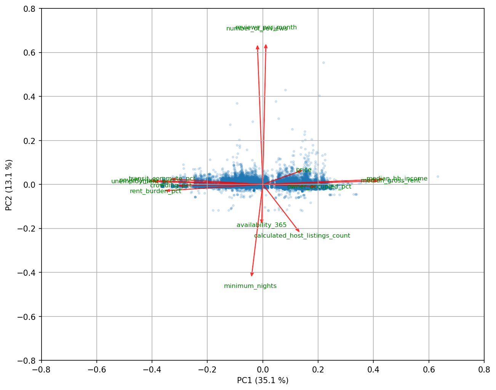

# Final Project 2: Data Integration, Research Question Refinement & PCA

**Team:** DongHyeok Kim, DongJun Lee

**Notebooks:** [Project2_Integration_PCA.ipynb](Project2_Integration_PCA.ipynb) (data integration) and [Project2.ipynb](Project2.ipynb) (PCA) | **Data:** [data/](data/)

## 1. Research question, audience and potential use

**Research question.** Among New York City Airbnb listings that were bookable in September 2026, how do listings differ in the way they operate (price, minimum stay, review activity, host portfolio size, availability), and are these differences related to the economic and housing conditions of the neighborhoods where the listings are located?

**Audience.** The primary audience is the people who actually use Airbnb: guests choosing where to book and hosts deciding how to price and list a property. Guests can use the neighborhood-level comparison to see whether a listing's price is typical for its area and what kind of neighborhood it sits in. Hosts can use it to see how their price, minimum stay and availability compare with others in their neighborhood.

The findings could also reach tenant advocacy offices, especially government-affiliated offices that provide support and legal assistance in housing disputes, such as the NYC Mayor's Office to Protect Tenants (https://www.nyc.gov/tenantprotections). These offices work with residents of neighborhoods where short-term rentals may compete with long-term housing. A neighborhood-level view of where commercial-style listings are concentrated could help them decide where to focus outreach.

**Relevance.**

- *Users (guests and hosts).* Prices vary widely (median $183, but a maximum of $31,538), so a single average tells a guest little. Users need to know what is typical for a specific neighborhood and how that relates to its income and rent level.
- *Advocacy offices.* They need to see whether listings run by hosts with many properties and open most of the year are concentrated in neighborhoods where residents are already rent-burdened. Our data connects each listing to its neighborhood's rent burden, poverty and median rent, which makes that comparison possible.

**Potential use.**

- *For users:* compare a listing's price, minimum stay and availability with the neighborhood norm, adjusted for neighborhood income and rent. This could support a booking or pricing decision.
- *For advocacy offices:* rank neighborhoods by the share of listings from multi-listing hosts and see whether the top ones are also high in rent burden. That gives them a list of neighborhoods where outreach is most likely to matter.
- *Further investigation:* test the pattern in the clustering stage of this project, then check flagged areas against housing-dispute or rent records.
- *Limit:* the data shows association, not cause. It cannot show that Airbnb activity raises rents or leads to disputes.

## 2. Data integration and preprocessing

**Primary dataset.** Inside Airbnb, New York City listings, snapshot of 14 September 2026 (29,918 listings, 19 variables). One row is one listing. Source: http://insideairbnb.com/get-the-data/

**Supplementary dataset.** NYC Department of City Planning, American Community Survey (ACS) 2020-2024 5-year estimates by Neighborhood Tabulation Area (NTA): the Economic and Housing files. One row is one NTA. Source: https://www.nyc.gov/content/planning/pages/resources#datasets (American Community Survey). In Project 1 we proposed the Community District/PUMA profile from the same agency, but that file contained no downloadable data, so we used the NTA-level files of the same ACS profiles.

**NTA boundaries.** `data/nta2020_boundaries.geojson`, converted from `geography/NTA2020.topo.json` in the NYC Department of Health and Mental Hygiene repository https://github.com/nychealth/EHDP-data.

**What a row represents in the combined dataset.** One Airbnb listing with a price, together with the ACS values of the NTA where it is located. Listings in the same NTA share the same neighborhood values.

**Identifiers.** The listings have no NTA code. We assigned each listing to the NTA whose boundary polygon contains its latitude and longitude, then merged on the NTA code (`GeoID`).

**Transformation before merging.** From the two ACS files we kept residential NTAs only (`NTAType == 0`), selected eight variables, and joined them into one table with one row per NTA (197 NTAs).

| Variable in our data | ACS column | Meaning |
|---|---|---|
| `poverty_pct` | `PBwPvP` | population below the poverty level (%) |
| `unemployment_pct` | `CvLFUEm2P` | unemployed, share of the civilian labor force (%) |
| `transit_commute_pct` | `CW_PbTrnsP` | workers commuting by public transportation (%) |
| `median_hh_income` | `MdHHIncE` | median household income (dollars) |
| `owner_occupied_pct` | `OOcHU1P` | owner-occupied housing units (%) |
| `crowding_pct` | `OcPR1plP` | housing units with more than one occupant per room (%) |
| `rent_burden_pct` | `GRPI30plP` | renters paying 30% or more of income on rent (%) |
| `median_gross_rent` | `MdGRE` | median gross rent (dollars) |

**Merge checks.** 19,406 rows before the merge and 19,406 after; 0 duplicated listing ids. Each NTA appears once in the neighborhood table. Listings are points and NTAs are areas, so each listing matches one NTA and nothing is aggregated or split. The listings are from 2026 and the ACS estimates cover 2020-2024, so we treat the ACS values as background characteristics of each neighborhood, not as measurements from the same moment.

**Missing values.**

| Missing | Count | Treatment |
|---|---|---|
| `price` | 10,512 | listings dropped |
| NTA values (listings in non-residential NTAs or outside every boundary) | 54 | listings dropped |
| `owner_occupied_pct` (Stuyvesant Town-Peter Cooper Village) | 14 | listings dropped |
| `minimum_nights` | 7 | listings dropped |
| `reviews_per_month` (listings with zero reviews) | 5,045 | set to 0 |

Final dataset: 19,331 listings in 195 NTAs.

**Variables excluded from PCA.** Identifiers (`id`, `host_id`, `host_profile_id`, `GeoID`), text fields (`name`, `host_name`, `neighbourhood`, `license`), `last_review` (raw date), `latitude` and `longitude` (location is represented by the NTA variables), `number_of_reviews_ltm` (overlaps with `reviews_per_month`), and the categorical variables `room_type` and `neighbourhood_group`. No encoded categorical variable enters the PCA.

**Standardization.** The variables are measured in dollars, days, counts and percentages. PCA finds directions of largest variance, so without standardization the variables with the largest numeric ranges would dominate. All inputs were standardized to mean 0 and standard deviation 1 with `StandardScaler`.

## 3. PCA results

**Input variables (14).** `price`, `minimum_nights`, `number_of_reviews`, `reviews_per_month`, `calculated_host_listings_count`, `availability_365`, `poverty_pct`, `unemployment_pct`, `transit_commute_pct`, `median_hh_income`, `owner_occupied_pct`, `crowding_pct`, `rent_burden_pct`, `median_gross_rent`.

**Explained variance.**

| Component | Explained variance ratio | Cumulative |
|---|---|---|
| PC1 | 35.1% | 35.1% |
| PC2 | 13.1% | 48.2% |
| PC3 | 10.4% | 58.6% |
| PC4 | 7.4% | 66.0% |
| PC5 | 7.0% | 73.0% |
| PC6 | 6.4% | 79.5% |
| PC7 | 5.1% | 84.6% |

The scree plot and cumulative explained variance plot are in [Project2.ipynb](Project2.ipynb).

**Components retained: 7.** Six components explain 79.5% of the variance, just under the 80% threshold, and seven explain 84.6%.

**What the components represent.**

| Component | Strongest variables (loading) | Interpretation |
|---|---|---|
| PC1 | `median_hh_income` (0.42), `median_gross_rent` (0.40), `poverty_pct` (-0.39), `unemployment_pct` (-0.38), `rent_burden_pct` (-0.34), `transit_commute_pct` (-0.32) | Neighborhood affluence |
| PC2 | `number_of_reviews` (0.62), `reviews_per_month` (0.62), `minimum_nights` (-0.40) | Review activity versus long minimum stay |
| PC3 | `owner_occupied_pct` (0.69), `rent_burden_pct` (0.40), `transit_commute_pct` (-0.38) | Owner-occupied residential setting |
| PC4 | `price` (0.76), `availability_365` (0.42), `minimum_nights` (-0.42) | Price |
| PC5 | `availability_365` (0.81), `minimum_nights` (0.39) | Availability |
| PC6 | `calculated_host_listings_count` (0.93) | Host portfolio size |
| PC7 | `minimum_nights` (0.69), `price` (0.56) | Long-stay, higher-priced listings |

The full loading table and heatmap are in the notebook.

**Biplot of PC1 and PC2.**

The arrows form two nearly perpendicular bundles. The neighborhood variables lie along PC1: income and rent point right, while poverty, unemployment, crowding, rent burden and transit commuting point left. The review variables point up and `minimum_nights` points down along PC2. Most points lie in a flat band because a few listings with very many reviews stretch the PC2 axis.

PCA identifies directions of variation, not clusters. Denser areas in the plot are not interpreted as groups.

**Relation to the research question and audience.** Listing behavior and neighborhood conditions appear as separate dimensions: how actively a listing is reviewed is largely unrelated to how affluent its neighborhood is. For guests and hosts, this means a listing should be compared with others in the same kind of neighborhood (PC1) before its price (PC4) or activity (PC2) is judged. For tenant advocacy offices, host portfolio size appears as its own component (PC6), separate from neighborhood affluence, so a neighborhood's economic profile does not by itself show where multi-listing hosts operate. That comparison has to be made directly, which the combined dataset now allows.

## 4. Limitations

- The listings (2026) and the ACS estimates (2020-2024) come from different periods.
- All listings in one NTA share the same neighborhood values, and eight of the fourteen inputs are neighborhood variables, so the first component is weighted toward neighborhood conditions.
- Listings without a price (35%) are excluded, so the results describe bookable listings.
- Skewed variables (price, review counts) were not log-transformed, so a few extreme listings stretch some components.
- `median_hh_income` is top-coded at 200,000 in two NTAs (270 listings).

## 5. How to reproduce

1. Download or clone this repository.
2. Run `Project2_Integration_PCA.ipynb` from the repository root. It reads the files in `data/` and writes `data/listings_merged.csv`.
3. Run `Project2.ipynb`. It reads `data/listings_merged.csv` and produces the PCA results.

Required packages: `numpy`, `pandas`, `openpyxl`, `matplotlib`, `seaborn`, `scikit-learn`.

